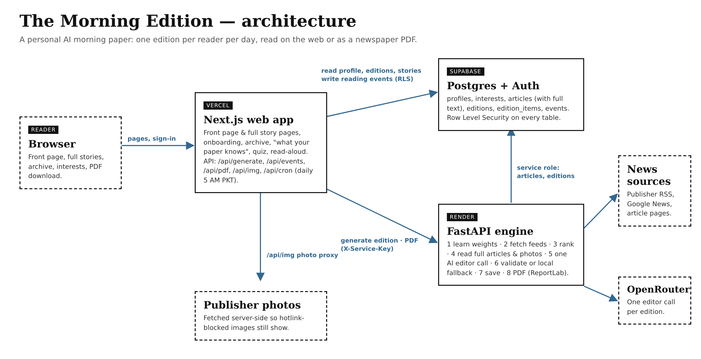

# The Morning Edition

**A personal AI morning newspaper.** News is scattered across dozens of sites, and people jump from link to link
and still can't name three things they learned. The Morning Edition learns what you care about, gathers matching
stories from across the web every day, and has an AI editor turn them into one newspaper made just for you —
with a front page, story pages, a downloadable PDF, an archive, and a paper that gets better the more you read.

Built for NaSCon'26. `SPEC.md` is the full specification.



## Features

- **60-second onboarding** — name your paper (live masthead preview), tap topics (twice = love), add specific
  phrases, pick a reading style and region.
- **A real front page** — masthead, giant lead headline, columns of headlines and one-line deks, an In Brief rail.
- **Full stories on the site** — the engine reads each chosen article from the publisher (Google News links are
  resolved to the real site), so story pages show the whole article with its photo, byline and reading time,
  plus key points, *why you're seeing this* and a credit link to the original. Where a publisher blocks this,
  the page falls back to the AI summary.
- **Photos that actually show** — publisher images are served through the app's own `/api/img` proxy, so sites
  that block hot-linking or still use plain http no longer leave blank boxes.
- **Comfortable reading** — NYT-style type (blackletter masthead, Newsreader headlines, Source Serif body,
  Libre Franklin labels), light / sepia / dark themes, adjustable text size and a reading progress bar.
- **Newspaper PDF** — page 1 is the front page; inside pages hold the full stories in three columns, with
  clickable headlines.
- **Archive** of every past edition, on the web and as PDF.
- **It learns** from which headlines you open, **how long you actually read**, and what you like, dislike or skip.
  See it all on *What your paper knows about you*.
- **Three Things You Learned Today** with a **morning quiz**, **Read it to me** (browser text-to-speech),
  **Explore** stories from outside your usual topics, and **Regenerate**.
- **Games** — Sudoku, Wordplay (a Wordle-style word game), Spelling Hive, Scrabble-style Letter Tiles and
  Connections, with a new puzzle every day.
- **Today's cartoons** — editorial cartoons from The New Yorker, The Guardian, The Observer, The Hindu, Dawn and
  The Express Tribune, gathered by the engine (`GET /cartoons`, cached for an hour).
- **Ask anything** — a glass chat bar at the bottom right answers questions about the news with sources.
- **Daily morning run** — a Vercel Cron job prints every reader's paper at 5 AM Pakistan time.
- **Always produces a paper** — if the AI fails, a local fallback edition is built from the sources.

## Architecture

Next.js (Vercel) + Supabase (Postgres, Auth, Row Level Security) + a Python FastAPI engine (Render) that fetches
RSS feeds, reads the full articles (trafilatura), makes **one** OpenRouter call per edition, and renders PDFs with
ReportLab.
See [docs/architecture.md](docs/architecture.md).

## Run it locally

**1. Database.** Create a Supabase project, turn off *Confirm email* (Authentication → Sign In / Providers), then
paste `supabase/schema.sql` into the SQL editor and run it once. **Already have a database from an earlier
version?** Run `supabase/migrations/002_article_body.sql` once to add the full-article columns.

**2. Engine** (Python 3.11+), from `engine/`:

```bash
python -m venv .venv
source .venv/Scripts/activate   # Windows Git Bash; macOS/Linux: source .venv/bin/activate
pip install -r requirements.txt
cp .env.example .env            # fill in real values
uvicorn main:app --reload --port 8000
```

Check: `http://localhost:8000/health` → `{"ok": true}`. Tests: `python -m pytest` (OpenRouter is mocked; no credits).
Feed check: `python -m sources --verify`. Sample PDF: `python -m pdf.render samples/sample_edition.json out.pdf`.

**3. Web** (Node 20+), from `web/`:

```bash
npm install
cp .env.example .env.local      # fill in real values
npm run dev
```

Open `http://localhost:3000`, sign up, and print your first paper.

## Environment variables

`engine/.env` (server only — never committed):

| Name | What |
|---|---|
| `SUPABASE_URL` | Supabase project URL |
| `SUPABASE_SERVICE_ROLE_KEY` | Supabase service-role / secret key |
| `OPENROUTER_API_KEY` | OpenRouter key |
| `OPENROUTER_MODEL` | e.g. `provider/model-name` |
| `SERVICE_SHARED_SECRET` | random string shared with the web app |
| `APP_PUBLIC_URL` | the web app's public URL |

`web/.env.local` (never committed):

| Name | What |
|---|---|
| `NEXT_PUBLIC_SUPABASE_URL` | Supabase project URL |
| `NEXT_PUBLIC_SUPABASE_ANON_KEY` | Supabase anon / publishable key (browser-safe) |
| `ENGINE_URL` | engine URL (`http://localhost:8000` locally) |
| `SERVICE_SHARED_SECRET` | same value as the engine |
| `CRON_SECRET` | random string; Vercel sends it to `/api/cron` for the daily morning run |

## How learning works

Each event moves a topic's weight: opens +0.10, likes +0.30, click-throughs +0.15, skips −0.15, dislikes −0.35,
and **reading time** from −0.05 (bounced in under 5 s) up to +0.30 (two minutes or more of active reading).
Events fade with a 14-day half-life, weights stay between 0.1 and 3.0, and liking an Explore story creates a new
learned interest. Every morning's ranking uses the new weights.

## How AI failure is handled

The engine retries once on timeouts, rate limits and server errors, repairs invalid output (unknown ids, wrong
lead count, missing fields, over-long text), and if anything still fails it builds the paper from local scores and
RSS snippets (`ai_status = fallback`) with a slim notice on the front page. A reader always gets a paper.
